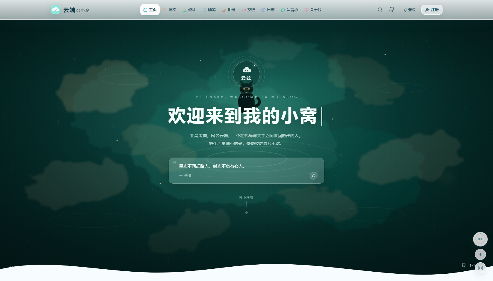
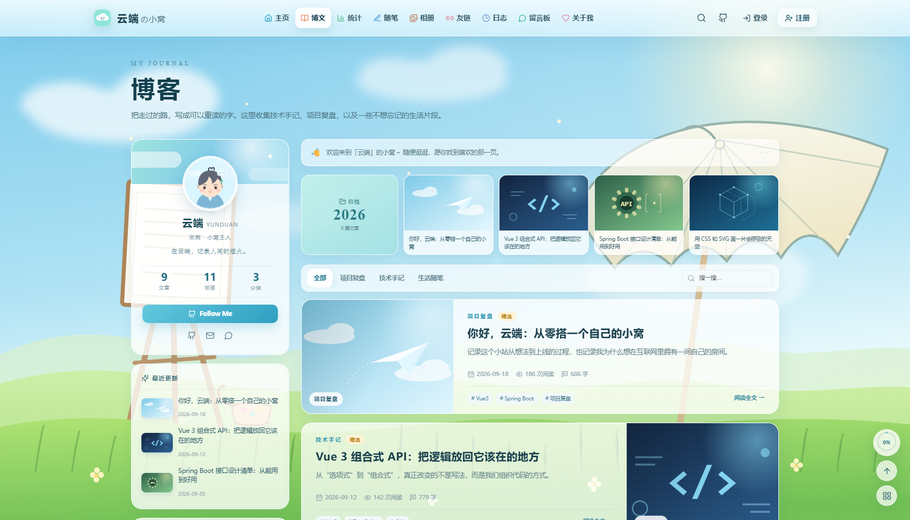
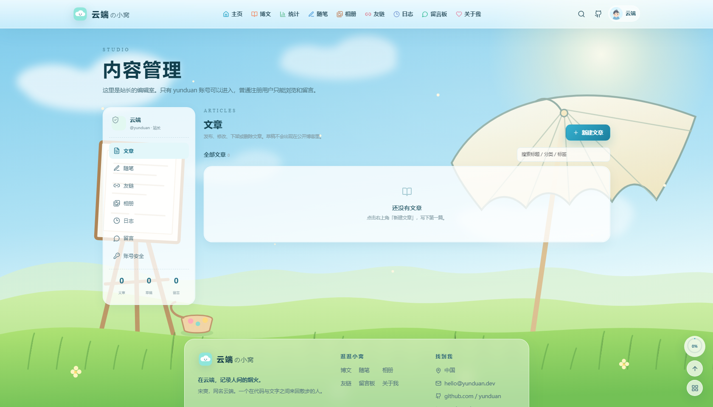

# 云端の小窝 · Yunduan Nest

宋爽（网名：云端）的个人网站。前端 **Vue 3 + TypeScript + Vite**，后端 **Spring Boot 3 + Spring Data JPA + H2**。

现在这套项目已经改成 **站长内容管理系统**：

- `yunduan` 账号：可以发布 / 编辑 / 删除文章、随笔、友链、相册、更新日志，也可以删除留言、修改密码。
- 其他注册用户：只能浏览、登录、留言，**看不到管理入口**，后端也会拒绝他们的管理请求。
- 初始数据库是空的：没有演示文章、留言、相册、友链，只保留一个站长账号。

> 页面里的天空、池塘、黑猫、画架、油纸伞、头像和所有封面，都是原创 SVG / CSS；没有复制参考站点的图片、头像或文章。

---

## 预览

| 首页 | 博客 | 内容管理 |
| --- | --- | --- |
|  |  |  |

> 预览图是之前用演示内容截的；实际首次启动时内容为空，登录站长账号后自己发布。

---

## 一、权限模型

| 能力 | 游客 | 注册用户（USER） | 站长（yunduan / ADMIN） |
| --- | --- | --- | --- |
| 浏览文章、随笔、相册、友链 | ✅ | ✅ | ✅ |
| 注册 / 登录 | ✅ | ✅ | ✅ |
| 发表留言 | ✅（匿名或登录） | ✅ | ✅ |
| 发布 / 编辑 / 删除文章 | ❌ | ❌ | ✅ |
| 编辑随笔、友链、相册、日志 | ❌ | ❌ | ✅ |
| 删除留言 | ❌ | ❌ | ✅ |
| 修改站长密码 | ❌ | ❌ | ✅ |

权限不是只藏起按钮，而是 **后端 `/api/admin/**` 强制校验**：

- 未登录：`401`
- 普通用户：`403`
- 只有用户名是 `yunduan` 且角色是 `ADMIN` 的账号能通过。

普通用户注册时，后端固定写入 `role=USER`，无法自己选择管理员角色。

---

## 二、第一次启动

### 1. 环境

这台电脑已经装好 **Temurin JDK 21**，位置：

```text
D:\codeTool\jdk-21
```

用户环境变量已经配置：

```text
JAVA_HOME = D:\codeTool\jdk-21
PATH      = ...;%JAVA_HOME%\bin
```

新开一个 `cmd` 验证：

```bat
java -version
javac -version
```

Node.js 也已安装。项目自带 Maven Wrapper，不需要单独安装 Maven。

### 2. 启动开发模式（两个进程）

打开项目目录：

```text
D:\codeProject\ssyundua.xyz
```

双击：

```text
start-all.cmd
```

它会自动打开两个窗口：

- 后端：`http://127.0.0.1:8080`
- 前端 Vite：`http://127.0.0.1:5173`

首次启动会下载依赖，可能几分钟。看到后端 `Started YunduanNestApplication`、前端 Vite ready 后，打开：

```text
http://127.0.0.1:5173
```

也可以手动开两个 `cmd`：

```bat
:: 窗口 1
cd /d D:\codeProject\ssyundua.xyz\backend
mvnw.cmd spring-boot:run
```

```bat
:: 窗口 2
cd /d D:\codeProject\ssyundua.xyz\frontend
npm.cmd install
npm.cmd run dev
```

### 3. 登录站长账号

```text
用户名：yunduan
密码：yunduan123
```

登录后，点击右上角头像 → **内容管理**，或直接访问：

```text
http://127.0.0.1:5173/admin
```

第一次登录后，建议立刻去 **内容管理 → 账号安全** 修改密码。

### 4. 发布第一篇文章

1. 登录 `yunduan`；
2. 进入「内容管理」；
3. 点击「新建文章」；
4. 填写标题、分类、正文，选择封面；
5. 想先保存不公开，取消勾选「发布到公开博客」，点「保存草稿」；
6. 想公开，勾选发布，点「保存并发布」。

文章保存后立即出现在博客页。普通用户看不到「内容管理」，也无法调用管理接口。

### 5. 上传相册照片

登录 `yunduan` → 内容管理 → 相册 → 新建照片：

1. 填写标题、分类、地点；
2. 点「选择照片上传」，选择本地图片；
3. 上传成功后会看到预览；
4. 点「保存」，照片就会出现在相册页。

支持 **JPG / PNG / WebP / GIF**，单张最大 **10MB**。
图片保存在：

```text
backend/data/uploads/
```

所以备份 `backend/data` 时，数据库和照片会一起备份。删除照片时，对应的图片文件也会删除。

---

## 三、当前数据是空的

首次启动只会创建：

- 站长账号 `yunduan`
- 空数据库

不会创建任何文章、随笔、友链、相册、日志、留言或访问数据。

如果想再次清空所有内容（包括自己写的文章、注册用户、留言、访问记录）：

1. 停止后端；
2. 删除目录：

```text
D:\codeProject\ssyundua.xyz\backend\data
```

3. 重新启动。

> 注意：这会重置站长密码为 `yunduan123`（或环境变量 `YUNDUAN_ADMIN_PASSWORD` 的值），并删除所有用户和内容。

---

## 四、开发时一定要两个窗口吗？

### 开发模式：是，但不用手动开

Vue 开发服务器和 Spring Boot 是两个进程。`start-all.cmd` 已经帮你自动打开两个窗口，不需要自己开。

### 生产模式：不是，可以只跑一个 JAR

项目已经支持把前端打包进 Spring Boot：

```text
build.cmd
```

它会：

1. 构建前端；
2. 把 `frontend/dist` 复制到 `backend/src/main/resources/static`；
3. 打包成 `backend/target/yunduan-nest-1.0.0.jar`。

然后双击：

```text
start-onejar.cmd
```

只需要一个窗口，访问：

```text
http://127.0.0.1:8080
```

前端页面和 `/api` 接口都在同一个进程里。

> 当前交付目录里已经带了一个构建好的 JAR（`backend/target/yunduan-nest-1.0.0.jar`），可以直接运行 `start-onejar.cmd`。以后修改了代码，再执行一次 `build.cmd` 即可。

---

## 五、在手机上访问（局域网）

手机和电脑连同一个 Wi-Fi 时，可以把电脑当作小型服务器，用手机浏览器打开网站。

### 第一次：放行防火墙

右键 **以管理员身份运行**：

```text
allow-firewall.cmd
```

它会放行 `8080` 和 `5173` 两个端口，只需要执行一次。

### 启动手机访问模式

双击：

```text
start-phone.cmd
```

窗口会显示类似：

```text
手机浏览器打开：
http://192.168.1.23:8080
```

在手机浏览器输入这个地址即可。

也可以手动查电脑 IP：

```bat
ipconfig
```

找到当前 Wi-Fi 的 IPv4 地址，然后用手机访问：

```text
http://你的IPv4地址:8080
```

### 手机能做什么

手机浏览器里可以：

- 浏览首页、博客、统计、相册、留言板；
- 用 `yunduan` 登录站长后台；
- 写文章、发随笔；
- **直接从手机相册选择照片上传到相册**；
- 留言、注册普通账号。

上传的照片会保存在电脑的：

```text
D:\codeProject\ssyundua.xyz\backend\data\uploads
```

### 注意事项

- 电脑必须保持开机，`start-phone.cmd` 窗口不能关；
- 手机和电脑必须在同一个 Wi-Fi / 路由器下；
- 如果手机打不开：
  - 确认已运行 `allow-firewall.cmd`；
  - 关闭电脑和手机上的 VPN / 代理；
  - 路由器不要开启“AP 隔离 / 访客网络”；
  - 用 `ipconfig` 确认 IP 没有写错；
- 这是局域网 HTTP，不要把这个端口映射到公网；
- 手机上传 iPhone 的 HEIC 照片可能不被浏览器支持，建议在相机设置里选择“兼容性最佳（JPEG）”，或先导出为 JPG；
- 离开这个 Wi-Fi 后手机就打不开了。想在户外访问，仍然需要云服务器或内网穿透/VPN；
- 这不会把项目“安装”到手机本地，后端和数据库仍然在电脑上。

### 移动端排版

所有页面都按 **360px / 390px / 430px** 三种手机宽度检查过，没有横向滚动。

重点优化了站长后台：

- 七个管理标签在手机上排成两行，不会藏在横向滚动里；
- 文章、照片、留言等列表自动改为「缩略图 + 文字 + 下方操作按钮」；
- 新建/编辑表单单列显示，输入框字号 16px，避免 iOS 聚焦时自动放大页面；
- 保存、发布、上传等按钮高度至少 44px；
- 相册上传区在手机上单列显示；
- 手机端后台隐藏右下角悬浮工具，避免挡住表单；
- 统计页图表在手机上可左右滑动查看完整曲线。

### 开发模式用手机看

如果要用 Vite 热更新：

```text
start-all.cmd
```

Vite 已监听 `0.0.0.0`，手机访问：

```text
http://电脑IP:5173
```

需要先放行 5173 端口。

---

## 六、项目结构

```text
yunduan-nest/
├── frontend/                    Vue 3 + TypeScript + Vite
│   ├── src/
│   │   ├── api/client.ts        接口、Token、错误处理、管理接口
│   │   ├── components/          场景、卡片、图表、弹窗
│   │   ├── views/
│   │   │   ├── AdminView.vue    站长内容管理后台
│   │   │   └── ...
│   │   ├── stores/auth.ts       登录态、isAdmin 计算
│   │   ├── router/              路由与 /admin 守卫
│   │   └── style.css
│   └── package.json
├── backend/                     Spring Boot 3
│   ├── src/main/java/ink/yunduan/nest/
│   │   ├── domain/              JPA 实体
│   │   ├── repo/                数据访问
│   │   ├── service/             登录、权限、统计
│   │   ├── web/
│   │   │   ├── AdminController.java   管理接口（强制站长权限）
│   │   │   ├── ArticleController.java 公开文章接口
│   │   │   └── ...
│   │   ├── seed/DataSeeder.java 只创建站长账号，不写演示内容
│   │   └── config/WebConfig.java CORS + 单 JAR 的 SPA 路由
│   ├── src/main/resources/application.yml
│   ├── src/main/resources/application-prod.yml
│   ├── mvnw / mvnw.cmd
│   └── pom.xml
├── deploy/                      Linux 部署示例
│   ├── yunduan.service
│   ├── yunduan.env.example
│   ├── Caddyfile
│   ├── nginx.conf
│   └── README.md
├── docs/                        预览图
├── scripts/
│   ├── preview.mjs              本地生产预览
│   └── lan-ip.ps1               自动获取局域网 IP
├── README.md
├── DOMAIN.md
├── start-all.cmd                开发模式：前后端两个窗口
├── start-onejar.cmd             生产模式：一个 JAR
├── start-phone.cmd              手机访问模式：局域网 8080
├── allow-firewall.cmd           放行 8080 / 5173（需管理员）
└── build.cmd                    构建单 JAR
```

---

## 七、接口

### 公开接口

| 方法 | 路径 | 说明 |
| --- | --- | --- |
| GET | `/api/site` | 站点信息 |
| GET | `/api/articles?category=&tag=&q=` | 已发布文章 |
| GET | `/api/articles/{slug}` | 已发布文章详情（草稿仅站长可预览） |
| GET | `/api/moments` | 随笔 |
| GET | `/api/gallery` | 相册 |
| GET | `/api/friends` | 友链 |
| GET | `/api/changelog` | 更新日志 |
| GET | `/api/messages` | 留言 |
| POST | `/api/messages` | 留言（登录可选） |
| GET | `/api/stats` | 统计 |
| POST | `/api/visits/track` | 记录访问 |
| POST | `/api/auth/register` | 注册（固定 USER） |
| POST | `/api/auth/login` | 登录 |
| GET | `/api/auth/me` | 当前用户 |

### 站长接口（必须 `Authorization: Bearer <token>`）

| 方法 | 路径 | 说明 |
| --- | --- | --- |
| GET | `/api/admin/articles` | 全部文章（含草稿） |
| POST | `/api/admin/articles` | 新建文章 |
| PUT | `/api/admin/articles/{id}` | 修改文章 |
| DELETE | `/api/admin/articles/{id}` | 删除文章 |
| GET/POST/PUT/DELETE | `/api/admin/moments...` | 随笔管理 |
| GET/POST/PUT/DELETE | `/api/admin/friends...` | 友链管理 |
| GET/POST/PUT/DELETE | `/api/admin/photos...` | 相册管理 |
| POST | `/api/admin/uploads` | 上传相册图片（multipart，字段名 `file`） |
| GET/POST/PUT/DELETE | `/api/admin/changelog...` | 更新日志管理 |
| DELETE | `/api/admin/messages/{id}` | 删除留言 |
| PUT | `/api/admin/password` | 修改站长密码 |

---

## 八、单 JAR 与服务器部署

### 本地单 JAR

```bat
cd /d D:\codeProject\ssyundua.xyz
build.cmd
start-onejar.cmd
```

访问 `http://127.0.0.1:8080`。

### 真正联网

推荐结构：

```text
浏览器
  │ HTTPS 443
  ▼
Caddy（自动证书）
  │ 反向代理 127.0.0.1:8080
  ▼
Spring Boot JAR（页面 + API + H2）
```

步骤概要：

1. 买一台 Linux VPS（Ubuntu 22.04/24.04，1 核 1G 够用）和域名；
2. 域名 A 记录指向服务器 IP；
3. 服务器安装 JDK 21（或 17+）；
4. 把 `yunduan-nest-1.0.0.jar` 上传到 `/opt/yunduan/`；
5. 按 `deploy/README.md` 配置 systemd；
6. 安装 Caddy，使用 `deploy/Caddyfile` 自动申请 HTTPS；
7. 防火墙只开放 22 / 80 / 443，**不要开放 8080**；
8. 访问 `https://你的域名`。

详细命令、systemd 文件、Caddy/Nginx 配置见：

- [deploy/README.md](deploy/README.md)
- [deploy/yunduan.service](deploy/yunduan.service)
- [deploy/Caddyfile](deploy/Caddyfile)
- [deploy/nginx.conf](deploy/nginx.conf)

> 如果服务器在中国大陆，需要 ICP 备案；不想备案就用海外服务器。
> 上线仍建议开启 HTTPS；`.xyz` 不强制 HTTPS，但证书和 443 端口应配好。

### GitHub Pages 静态展示（可选）

GitHub Pages 只能托管静态文件，不能运行 Spring Boot。项目内置了“静态展示模式”：

- 页面检测不到 `/api/site` 时，自动读取 `frontend/public/data/*.json`；
- 文章、相册、友链、日志、留言和统计显示导出的快照；
- 登录、注册、留言、上传和后台管理会提示：

  ```text
  目前此功能不可用：当前是 GitHub Pages 静态展示版……
  ```

- 检测到本地后端时，自动恢复完整功能，正常登录和写文章。

#### 第一次部署

1. 本地双击 `start-onejar.cmd`，确认网站能打开；
2. 运行：

   ```text
   export-pages.cmd /仓库名/
   ```

   - 仓库是 `https://用户名.github.io/仓库名/`：传 `/仓库名/`；
   - 仓库是 `用户名.github.io` 或使用自定义域名：不传参数。

3. 脚本会导出 `frontend/public/data` 和照片，并生成静态页面；
4. 把项目推到 GitHub；
5. 推送后，GitHub Actions 会自动构建并更新 `gh-pages` 分支；
6. 仓库 **Settings → Pages → Build and deployment** 选择：

   ```text
   Deploy from a branch → gh-pages → / (root)
   ```

7. 等待 Pages 构建完成，访问 Pages 地址。

> 当前 `s1316339343/ssyunduan.xyz` 仓库已经按这种方式发布，不需要再改 Pages 设置。

GitHub Actions 文件：

```text
.github/workflows/deploy-pages.yml
```

#### 以后更新

```text
本地后台发布文章
→ 运行 export-pages.cmd /仓库名/
→ git add .
→ git commit -m "update posts"
→ git push
→ 等 GitHub Actions 部署完成
```

别人刷新页面就能看到新内容；不是后端实时更新，每次都需要重新导出和推送。

#### 注意

- **不要提交 `backend/data/yunduan.mv.db`**，里面有密码哈希和用户数据；`.gitignore` 已排除；
- 只提交 `frontend/public/data` 和 `frontend/public/uploads`；
- GitHub Pages 的登录、留言、上传不可用；静态版只读；
- 如果使用 `yunduan.xyz` 自定义域名，在 Pages 设置里填 `yunduan.xyz`，并把 DNS 按 GitHub 提示配置；同时在仓库 Variables 里设置 `PAGES_BASE=/`，否则子路径会错。

---

## 九、上线前检查

- [ ] 登录 `yunduan`，在「账号安全」里改掉默认密码。
- [ ] 生产环境使用 `SPRING_PROFILES_ACTIVE=prod`，关闭 H2 控制台。
- [ ] 后端只监听 `127.0.0.1`，由 Caddy/Nginx 对外提供 HTTPS。
- [ ] 不要把 8080 暴露到公网。
- [ ] 定期备份整个 `backend/data/`（包含 `yunduan.mv.db` 和 `uploads/` 照片），建议停服后复制。
- [ ] 如果注册开放，考虑加验证码 / 频率限制；当前是演示级。
- [ ] 修改 `SiteController` 里的域名、邮箱、GitHub。
- [ ] 把友链示例替换成真实内容（当前初始为空）。

### 安全说明

- 密码 BCrypt 哈希保存。
- 管理接口在服务端校验，不依赖前端隐藏按钮。
- 登录 Token 存在服务端内存，**重启后端后所有登录会失效**。
- 修改密码会让所有旧 Token 失效。
- 当前没有邮箱验证、找回密码、验证码和频率限制；公开注册前建议补上。
- H2 适合个人站起步；访问量变大后换 MySQL / PostgreSQL。

---

## 十、常见问题

**Q：为什么启动后没有文章？**
这是正常的。演示数据已经清空，登录 `yunduan` 后去「内容管理」发布。

**Q：普通用户能看到「内容管理」吗？**
看不到；即使手动访问 `/admin`，路由会拦截，后端也会返回 403。

**Q：一定要两个 cmd 窗口吗？**
开发模式是两个进程，但 `start-all.cmd` 会自动打开。生产模式用 `build.cmd` + `start-onejar.cmd`，只有一个 JAR。

**Q：怎么改站长密码？**
登录后进入「内容管理 → 账号安全」。改完会退出，重新登录即可。

**Q：忘记站长密码怎么办？**
停止后端，删除 `backend/data`，重启会按默认密码重新创建 `yunduan`（会清空内容）；或者在 H2 控制台手动改密码哈希。

**Q：怎么备份？**
停止后端，复制整个 `backend/data/` 目录（数据库 + 上传的照片）。

**Q：`yunduan.xyz` 打不开？**
先确认 DNS 的 A 记录是否指向服务器；如果配了 HTTPS，确认 80/443 已放行、证书已签发。

---

## 十一、定制

- 站点名称 / 域名 / 邮箱 / GitHub：`backend/.../web/SiteController.java`、`frontend/src/stores/site.ts`
- 颜色 / 字体 / 圆角：`frontend/src/style.css`
- 天空、池塘、黑猫、画架、伞、封面、头像：`frontend/src/components/`
- 相册上传：文件保存在 `backend/data/uploads/`，由 `UploadController` / `UploadService` 处理；开发模式通过 Vite 的 `/uploads` 代理显示
- 导航：`frontend/src/components/SiteHeader.vue`
- 管理后台：`frontend/src/views/AdminView.vue`
- 权限逻辑：`backend/.../service/AuthService.java`、`backend/.../web/AdminController.java`

文章、随笔、友链、相册、日志、留言现在都通过后台管理，不需要再改 `DataSeeder.java`。

---

## 十二、域名

默认使用 `yunduan.xyz`。域名说明见 [DOMAIN.md](DOMAIN.md)。

> 上线仍建议开启 HTTPS；`.xyz` 本身不强制 HTTPS，但 Caddy 可以自动申请证书。

---

## License

代码 MIT；文章、插画和站点文案保留所有权利。发布前替换成自己的内容。
